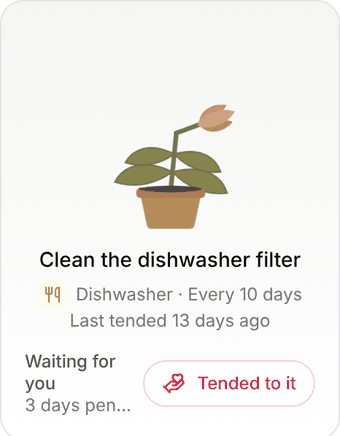
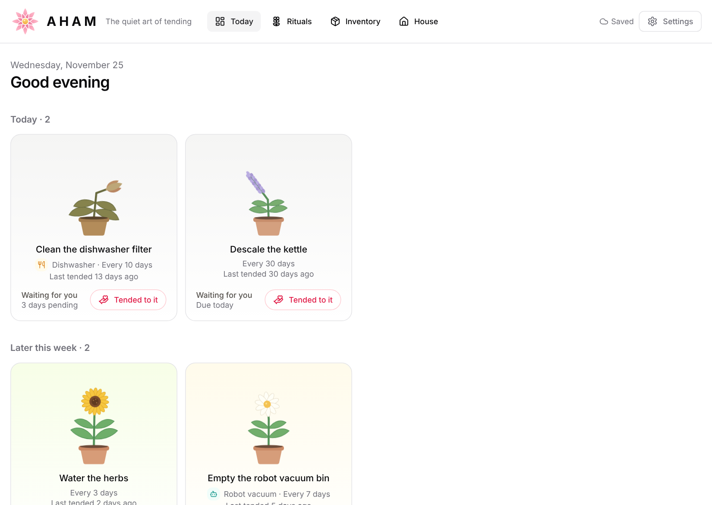
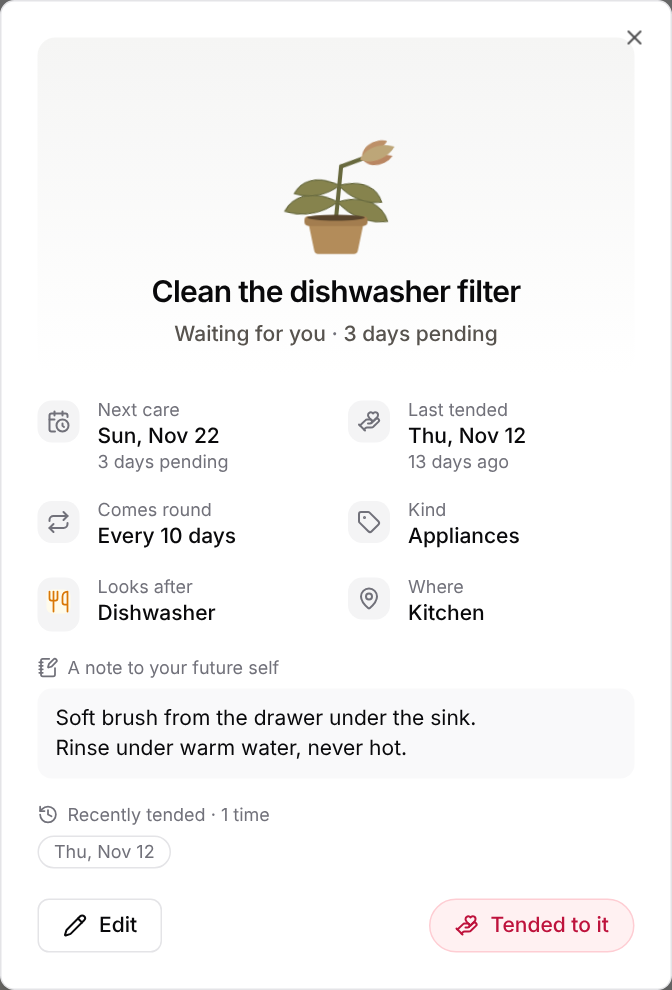
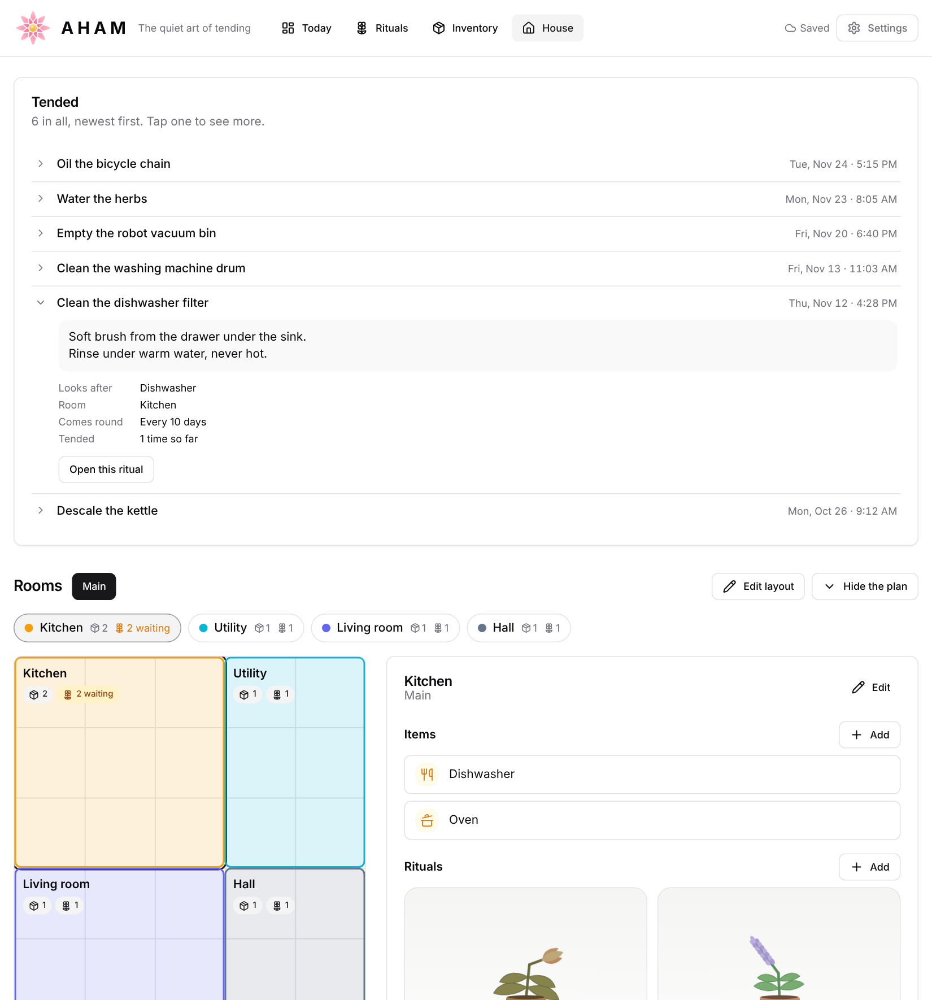

## TL;DR

AHAM is a home-care tracker I built for my own house: an inventory of what's in each room, and a little flowering plant for every recurring chore that droops and turns brown if you ignore it and perks back up when you tend to it. The one thing to remember is that I treated upkeep as *care*, not a to-do list, so there is no red, no "overdue", and at most one gentle notification a day.

## Fact box

| | |
|---|---|
| **Status** | Live, self-hosted, in personal use |
| **Role** | Solo: product, design, build, deploy (pairing with Claude Code) |
| **Stack** | React 18, TypeScript, Vite, Tailwind · Express · SQLite (`node:sqlite`) · MCP · Web Push · Docker, Traefik, Cloudflare Tunnel on a Hetzner server |
| **Timeline** | 6 days: first commit Nov 18, 2026, evening reminders shipped Nov 23 (35 commits) |

## The itch

The tools I know of treat looking after a home as work. Most to-do apps turn a descaled kettle into a task that goes red and then makes you feel behind. Most home-inventory apps are databases: they know your dishwasher's serial number and nothing about the Tuesday you last cleaned its filter. Neither feels like *looking after* a home, which, for me, is closer to a calm evening habit than a chore list. So the brief I gave myself was: make tending to things feel therapeutic.

## What it does

AHAM keeps two things and connects them. The **inventory** is everything in the house, grouped by room, each item with its own icon. A **ritual** is a recurring act of care ("clean the dishwasher filter, every 10 days"), and every ritual grows its own plant.



The plant is the status light. How alive it looks is a function of where the ritual sits in its interval: fresh and in bloom right after you tend to it, leaves sagging as the day approaches, and once it's past its day the stem bows fully and everything dries to brown. It never dies. The worst state is "Waiting for you · 3 days".



- **Today** is deliberately minimal: what's due today (plus anything already waiting) and what's coming before the week ends. No counters, no charts.
- **Tapping a card shows it; it never edits it.** The details view has the plant, next care, last tended, the note you left for your future self, and recent history. Editing is a separate, deliberate button.



- **House** opens on a plain, permanent list of everything ever tended ("Oil the bicycle chain, Tue, Nov 24 · 5:15 PM"), then the rooms. Tapping a room shows its items and rituals. The floor plan (a simple grid, 5 tiles wide and 10 long, because the house is narrow) is optional and hidden until you ask for it.



- **An evening reminder** at 19:00, on each device, names the rituals due tomorrow. Nothing is sent on days when nothing comes round.
- **An agent can use it.** The same app is exposed as an MCP server, so Claude can add an item, list what's waiting or read the tended log. Everything it does is recorded as done by the agent.

**What it deliberately doesn't do:** no points, streaks or scores; nothing red and no "overdue" anywhere; no nagging (one notification a day at most); no accounts or sharing beyond a single login for the household; no AI inside the app itself (the agent connects from outside).

## How it works

```
 phone / laptop (installable web app)
        │  Cloudflare Access (login) → Cloudflare Tunnel → Traefik
        ▼
 ┌──────────────────────── one Express process ─────────────────────────┐
 │  React app (static)   REST API   MCP server (/mcp)   calendar feed   │
 │                        │              │                              │
 │                        └──── same validated store functions ─────┐   │
 │  evening scheduler ─► web push ─► service worker on the phone    │   │
 └──────────────────────────────────────────────────────────────────┼───┘
                                                                    ▼
                         SQLite (WAL) on a Hetzner volume, daily backups
```

- **Front end:** React and Tailwind. The plants are hand-written SVG and CSS, no animation library. A single function, `vitality()`, turns "how far through its interval is this ritual" into a pose: lean, bow, leaf angle, colour, how open the bloom is.
- **One server process:** serves the built app, the REST API, the MCP endpoint (Streamable HTTP, stateless, 12 tools), an `.ics` calendar feed and the notification scheduler.
- **Storage:** SQLite through Node's built-in `node:sqlite`. 9 tables, WAL mode, foreign keys on, a daily backup (last 7 kept), and an audit log of who changed what (`ui` or `agent`).
- **Deploys:** every push to `main` runs the automated checks (87 of them), rsyncs the code to the server over SSH, rebuilds the container and waits for a health check. There are no open ports: Cloudflare's tunnel reaches Traefik, which routes by hostname.

### Decisions & trade-offs

- **Chose SQLite over Postgres** because it's one household and one file. A backup is a file copy and it lives on a mounted volume. The cost is a single server and a single writer, which is fine here.
- **Chose rule tables over an LLM for small judgements** like "which icon is this item?". They're instant, free, testable (34 cases), and the UI can say *why* ("chosen because 'vacuum' is in the name"), with a manual override as the final say.
- **Chose a permanent log with name snapshots over deriving history from the rituals.** Each "Tended to it" is its own row holding the ritual's name, item, room and note as they were *at that moment*, with no foreign keys, so it still reads correctly after a rename or a delete.
- **Chose tap-to-view over tap-to-edit.** A tap on a card should never put a form in front of you.
- **Chose an SSH-and-rsync deploy from GitHub Actions over an image registry plus Watchtower**, because it's the simplest thing that works. The trade-off is that GitHub needs SSH access and holds a deploy key; the app's own secrets stay on the server, never in GitHub.
- **Chose web push over email or an app-store app**, accepting that on iPhone it only works from an installed Home Screen app.
- **Chose to expose MCP before building an in-app chat**, so any MCP client works and the agent gets exactly the same validated paths as the UI.
- **Skipped OAuth on the MCP endpoint** (for now). It means claude.ai's custom-connector screen can't connect; clients that take a header can, and I added `X-API-Key` because that screen reserves `Authorization`.
- **Skipped accounts and multi-user.** One shared login behind Cloudflare Access is enough for one home.
- **Skipped offline caching.** The service worker only receives the reminder; the app itself needs the server.

## What was hard

**Changing a live database without losing anything.** After real data existed I shipped four changes that touched its shape: an icon per item, a plant per ritual, a permanent tended log, and shrinking the house plan from 12×8 to 5×10 (which would have pushed rooms off the edge). The rules I settled on: additive columns only, guarded by `PRAGMA table_info` so they run once; one-off backfills guarded by a flag; a safety copy of the database before anything rearranges rooms; and, most useful, **tests that build a database with the previous version of the code and start the new server on top of it**, then restart three times to prove nothing is copied twice. What failed first was my assumption that each ritual's last 30 dates were "history". They were capped and deleted with the ritual, which is what led to the permanent log.

**A login in front of everything breaks everything that can't log in.** The iPhone fetches a home-screen icon in a background request that carries no credentials, so behind a login the icon can't be fetched (my best explanation for why mine wouldn't show). MCP clients and calendar apps can't type a password. And my own deploy check hit the login, got a 401 and reported a perfectly healthy app as failed (a separate bug, a command swallowing the rest of the script's input, had been hiding that for a while). The fix was to stop treating "protected" as one switch: a short, explicit list of public paths (icons, manifest, health) that show nothing private, tokens for machine endpoints, and a test that prints what's reachable without a password.

## What I learned

- **Test migrations against a database made by the old code, not a fresh one.** A fresh database never has the awkward state.
- **Make the dangerous state loud.** The compose file refuses to start unless the data folder already exists, because an unmounted volume would otherwise silently create an empty database on the wrong disk.
- **Time is the part that bites.** "19:00" means 19:00 on *each device*, across daylight saving, once a day, even through restarts. I compute it per device with `Intl` instead of storing offsets, and I check the encryption by decrypting the message back to the original text.
- **Your test tools can lie.** Playwright's default headless browser reports notification permission as denied even after granting it, which looked exactly like my bug.
- **Wording and colour are features.** "Tended to it", "Waiting for you" and a plant that browns instead of a red badge changed how the app feels more than any layout did.
- **Plain beat clever.** I first showed completed rituals as icon-and-plant cards on a room view. The feedback was that it should just be a big plain list: what was done, on which day, at what time. The plain list was better.
- **What I'd do differently:** design the log of what's been done on day one, work out which paths must be public before adding a login, and use a pull-based deploy so no SSH key sits in GitHub.

## What's next

- OAuth on the MCP endpoint, so the agent works from claude.ai and the phone app.
- An in-app chat on the same tools.
- A reminder-time picker, and an option to mention what's still waiting.
- A pull-based deploy (image registry plus Watchtower), to retire the SSH key.
- Finish the rename from the old name: the repo, server folder and container still say `maha`.
- Pick the typeface (three warm, India-designed options are rendered and waiting).

## Try it

- **Demo:** none public. It holds a real household's data and sits behind a login, so the screenshots above are from sample data.
- **Source:** [github.com/byteofprash/maha](https://github.com/byteofprash/maha) (public; the repo still carries the app's old name)
