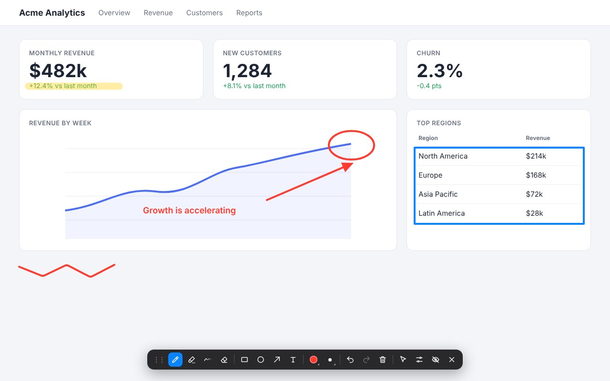
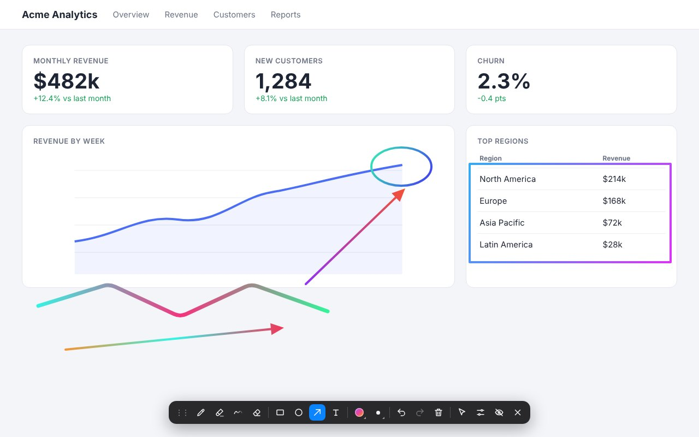
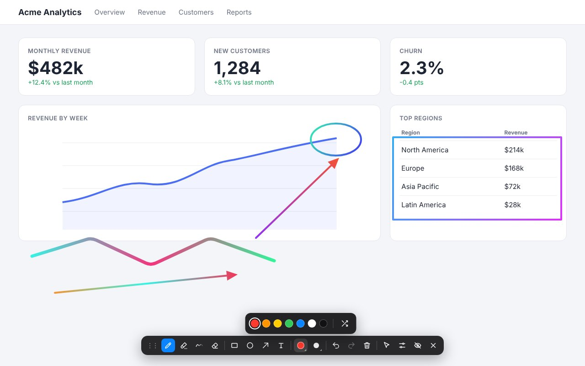

## TL;DR

Meetlo Picasso lets you highlight, circle and point at things on a web page while you present. The one thing to remember: it draws inside the page itself, so your drawing is part of the window you share, and you never have to share your whole screen.

## Fact box

| | |
|---|---|
| **Status** | Built (v0.4.0), landing page live, waiting on the Chrome Web Store listing |
| **Role** | Solo, with Claude Code writing the code |
| **Stack** | Chrome Manifest V3, vanilla JS, HTML canvas in a Shadow DOM, static landing page on EY430 |
| **Timeline** | Nov 2026 |

## The itch

When you present in Zoom, Google Meet or Teams, the sharpest way to share is a single Chrome window instead of your whole desktop. It keeps notifications, other tabs and half-finished work out of view.

The catch is that screen-drawing apps live above the desktop. Share one window and your arrows and circles vanish, because they were never part of that window. Your audience sees a clean page and you are left saying "look at the number on the right, no, the other right".

I wanted a pen that lives inside the page, so whatever I draw is automatically part of what gets shared.

## What it does

Click the toolbar icon or press **Alt+Shift+D** and a transparent canvas covers the page, with a small toolbar at the bottom. You get a pen, a highlighter, fading ink that disappears on its own, an eraser, rectangles, circles, arrows and text. Colors and thickness pop up on hover so the toolbar stays small. Holding Shift gives straight lines, squares and perfect circles.



Shuffle mode gives every stroke its own random gradient, which is mostly there because it looks good on a call.



Press **H** to hide the toolbar before you present, **Esc** to finish. Closing erases everything.



**What it deliberately doesn't do:** no saving or exporting drawings, no accounts, no analytics, no access to the sites you visit, and no drawing over Chrome's own UI, other apps or the Web Store and `chrome://` pages.

## How it works

```
click icon / Alt+Shift+D
        │
        ▼
background.js (service worker)
  ├─ message the page: already injected? → toggle
  └─ if not → chrome.scripting.executeScript(content.js)
                    │
                    ▼
        content.js in the page
          fixed host element, max z-index
            └─ Shadow DOM
                 ├─ <canvas> (full viewport, devicePixelRatio aware)
                 └─ toolbar, popups, text editor
          chrome.storage.local → tool, color, thickness, toolbar state
```

- **`background.js`**: a tiny service worker that injects the drawing script only when you ask for it, and flashes an "N/A" badge on pages Chrome won't let it touch.
- **`content.js`**: everything else. A canvas fixed over the viewport, the toolbar, and the tools.
- **Shadow DOM**: the toolbar and canvas live in a shadow root, so the page's CSS can't restyle them and they can't leak into the page.
- **Options page**: points to Chrome's own shortcut settings instead of reimplementing them.

### Decisions & trade-offs

- **Chose injecting on demand over a standing content script**, because it lets the extension ask for `activeTab`, `scripting` and `storage` and nothing else. No host permissions keeps the privacy policy short and gives users nothing to be nervous about. The trade-off is that it can't pre-load on pages, so the first open injects a script.
- **Chose drawing inside the page over a desktop overlay**, because that is the whole point: it survives single-window sharing. The trade-off is that it can't draw over Chrome's UI, other apps or browser fullscreen video.
- **Chose Chrome's own shortcut settings over a custom key recorder**, because Chrome already handles conflicts and a Global scope that works while Zoom has focus.
- **Chose screen-attached drawing over page-attached drawing.** Strokes stay put when you scroll instead of being anchored to the page content. That's simpler and matches how a laser pointer or marker works on a shared screen.
- **Skipped saving drawings**, because "closing erases everything" is the privacy story, and it is simple to explain and to keep true.
- **Skipped a build step.** One content script, plain JavaScript, loads unpacked.

## What was hard

**Making a drawing layer that doesn't fight the page.** A transparent canvas over a web page sounds simple until you want to scroll, click through and type. The canvas takes the pointer so you can draw, but the wheel still scrolls the page, Space temporarily lets clicks through, and **I** toggles a full "interact" mode. The shortcut also has to keep working while focus is inside an iframe, even though the drawing layer only covers the top page.

**Fading ink without a mess.** Fading strokes need to stay fully visible for a moment and then fade, so each one carries its own timestamp and a single animation frame loop redraws only while something is fading.

## What I learned

- **Technical:** Manifest V3 plus `activeTab` is enough for a surprisingly capable extension, and asking for less is a feature. A Shadow DOM is the right default for any UI you inject into someone else's page.
- **Product:** the best constraint was "it must still work when you share one window". Every decision followed from it.
- **Process:** writing the privacy policy early forced the permission list to stay honest.
- **Differently next time:** TODO (yours to fill in).

## What's next

- Replace the placeholder store link on the landing page with the real listing once Google approves it.
- Host the demo video and screenshots with the landing page. The first deploy went up without the big media.
- Open question: is a laser-pointer mode (a dot that follows the cursor and leaves no ink) worth adding?

## Try it

[Landing page](https://ey430-meetlo-picasso.byteofprash.com) · Source: private for now
