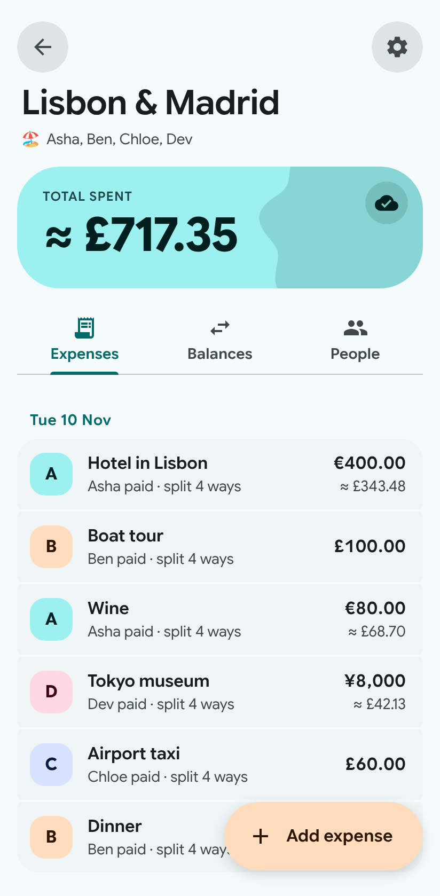
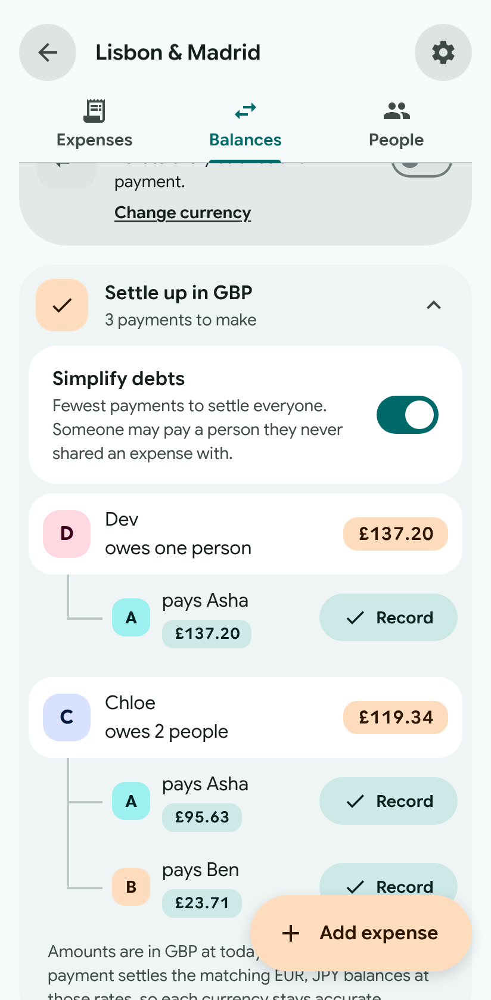

## TL;DR

Splitdumb is a Splitwise-style app for group trips where everyone pays in whatever currency is in their pocket. The one thing to remember: it never converts the books, because every balance stays in the currency it was paid in and your own currency is just a lens on top.

## Fact box

| | |
|---|---|
| **Status** | Live, used on a real group trip |
| **Role** | Everything: product, design direction, testing. Built with Claude Code as my pair programmer |
| **Stack** | Vanilla JS PWA (no build step), Vercel serverless functions, Vercel Redis, Material 3 Expressive (from my Twain app), Playwright |
| **Timeline** | First usable version in four days (12–15 Nov 2026), refined from real use since |

## The itch

It started as a bar bet. We were travelling through Vietnam, and over drinks Vishvesh, Suganth and I got into an argument about how easy it has become to build things today. The most obvious thing to build was the thing we all needed on that trip: a way to split expenses when everyone pays in a different currency.

That is the whole brief I gave myself. I wanted a bill splitter that works the way a trip actually goes: one person pays in euros, another in pounds, a third in dong, and nobody wants to do exchange-rate maths at the airport. Friends should join by tapping a link, with no accounts, and it should look good, using the Material 3 Expressive design I'd already built for Twain.

## What it does

Create a trip, add the people, and log expenses. Each expense is recorded in the currency it was really paid in, with who paid (one person or several) and how it's split: equally, by exact amounts, by percentage, or by shares.



Every phone picks its own currency in a first-run popup. Totals and "≈" amounts are shown in it, so two friends can open the same trip and each see their own money. Friends join through an invite link, and changes show up on everyone's phone within a few seconds. It keeps working offline and syncs when the connection comes back.


Balances are listed per currency, for information. **Settle up** sits at the top, in your own currency: one short list of who pays whom for the whole trip, with a Record button on each. It also has a "Simplify debts" switch like Splitwise's, and a CSV export for the spreadsheet people.



**What it deliberately doesn't do:** no accounts or passwords (the invite link is the access), no receipts or photos, no categories, no push notifications, and no live exchange-rate locking beyond the moment a payment is recorded.

## How it works

```
phone (PWA, vanilla JS)                 Vercel                     Vercel Redis
  local copy + outbox of changes  ──►  /api/trip   ──────────────►  trip:meta
  polls every 5 s, retries offline ◄──  validates, merges small ops   trip:people (hash)
                                                                      trip:expenses (hash)
  Claude (chat) ───────────────────►  /api/mcp   (add / read expenses by chat)
```

- **`logic.js`**: one pure module for the money maths (splits, balances per currency, settling, CSV). The browser, the server and the tests all use the same file, so they can't disagree.
- **`api/trip.js`**: a single serverless function. The browser sends small operations ("put this expense", "delete that person") instead of whole trips.
- **Redis layout**: people and expenses are separate hash fields, so two phones editing at the same time merge instead of overwriting each other.
- **Service worker**: network-first, so a new deployment reaches phones straight away, with the cache used only when offline.
- **`api/mcp.js`**: a small MCP server, so Claude can add and read expenses from a chat.

### Decisions & trade-offs

- **Chose per-currency balances over converting everything to a trip currency**, because rates move and each person thinks in their own money. Skipped a fixed "base currency" per trip.
- **Chose an unguessable link over accounts**, because friends join by tapping a message. The trade-off is that anyone with the link can edit or delete, so it's meant for a trusted group.
- **Chose small operations in separate hash fields over saving the whole trip**, so concurrent edits merge. The trade-off is that there are no transactions: the last write to a single item wins.
- **Chose polling every 5 seconds over websockets**, because it fits serverless and is trivial to reason about. The trade-off is a few seconds of lag.
- **Chose vanilla JS with no build step over a framework**, because Twain already worked that way and the app stays tiny. The trade-off is hand-rolled DOM helpers.
- **Skipped an iPhone-style design on the main branch.** I built it, then parked it on its own branch to keep one consistent look for now.

## What was hard

**Settling up across currencies.** I got this wrong twice. First, everything was converted into a trip currency with saved rates, which broke the moment friends wanted their own currency. Then I settled per currency, which turned three people into up to six payments in three currencies. What finally worked: balances stay per currency as the source of truth, and the viewer's currency is only presentation. Settling happens once, in the viewer's currency, and each payment carries "legs": the original-currency amounts it actually settles, at that day's rates. Recording every suggested payment must bring everyone to exactly zero, in both simplified and per-pair mode, and deleting a payment must restore every balance exactly. Those two rules became property tests. I also had to delete the stale settlement records from the live database; I backed them up first and checked afterwards that every expense was untouched.

**A stale app after a deploy.** My first service worker served the cached copy and refreshed it in the background. After I changed the data model, a friend's phone still ran the old app against the new server and showed an "undefined" currency. The fix was a network-first worker, a forced reload for phones stuck on old versions, and an app version in the profile so a stale phone is easy to spot.

## What I learned

- **Technical:** store facts and derive views. Per-currency nets are the truth, and rates only appear at display time and at the moment of payment. Test money maths with invariants ("settle everything, get zero"), not just examples. Cache policy matters as much as the code you ship.
- **Product:** ask "whose currency?" before designing the data model. I changed that answer twice. Using it on a real trip found things no test would.
- **Process:** a shared pure-logic module kept the browser, the API and the MCP server honest.
- **Differently next time:** write the invariants first, and build backup and export on day one. They came later, after real data existed.

## What's next

- Automatic backups, and a guard so a phone never silently throws away its copy of a trip.
- Read-only invite links, for people who should see but not edit.
- Bringing the Apple-style design back on iPhone, once I decide whether to maintain two looks.
- Open question: should the invite link be enough, or does a group of strangers need real accounts?

## Try it

- **Demo:** <!-- TODO(prash): add the live URL (and set demoUrl above) -->
- **Source:** private repo for now <!-- TODO(prash): make it public, or leave repoUrl empty -->
