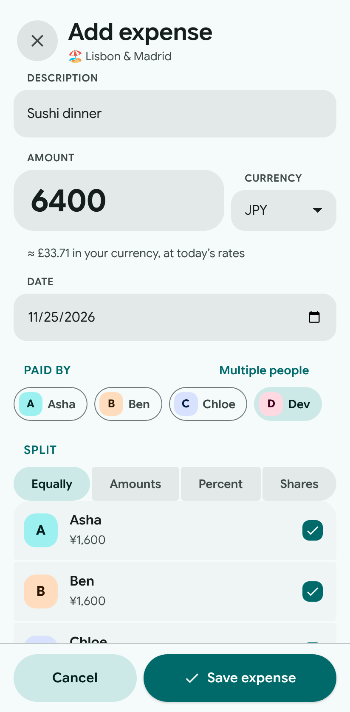

## TL;DR

Splitdumb is basically Splitwise for group trips where everyone's paying in whatever currency they've got on them. The one idea behind it: it never converts anything. Every balance stays in the currency it was paid in, and your own currency is just the way you look at it. It took me two wrong attempts to get there, so "idea" is generous.

## Fact box

| | |
|---|---|
| **Status** | Live, used on a real group trip |
| **Role** | The three of us (me, Vishvesh and Suganth) as the team, with Claude Code writing the code |
| **Stack** | Vanilla JS PWA (no build step), Vercel serverless functions, Vercel Redis, Material 3 Expressive (from my Twain app), Playwright |
| **Timeline** | Roughly 70–80% built in one taxi ride (12 Nov 2026), then small changes throughout the trip as we used it |

## The itch

Ten years ago we split every expense on our Thailand trip using Splitwise and it was fine. Ten years later we're in Vietnam, want to do the same, and the app feels ancient. Ten years! In my day that was barely a software update. Then it tells us we can add only three expenses a day. Three! Every coffee, every ride, every bloody snack is its own expense, so that's gone in an hour.

So we said fuck it, we'll build our own. Me, Vishvesh and Suganth, in the back of a taxi going from the hotel to an ATV track. Roughly 70 to 80 percent of the app got built on that one ride, which says a lot about how little else I had going on. A taxi ride. Back in the day that was when you looked out the window and thought about your life. After that we kept tweaking it all through the rest of the trip, as we actually used it.

What we wanted was simple. A trip splitter that doesn't cap how many expenses you add, handles a different currency for every payer, lets friends join by tapping a link (no accounts, because nobody wants to sign up for yet another thing), and looks good, using the Material 3 Expressive design I'd already built for Twain.

## What it does

Create a trip, add the people, and log as many expenses as you like. No daily limit, because we're not animals. Each expense is recorded in the currency it was really paid in, with who paid (one person or several) and how it's split: equally, by exact amounts, by percentage, or by shares.


Every phone picks its own currency in a popup on first run. Totals and "≈" amounts show in that currency, so two friends can open the same trip and each see their own money. Friends join through an invite link, and changes show up on everyone's phone within a few seconds. It keeps working offline and syncs when the connection comes back, which, for something built in a taxi, is frankly showing off.



Balances are listed per currency, just for information. **Settle up** sits at the top, in your own currency: one short list of who pays whom for the whole trip, with a Record button on each. It also has a "Simplify debts" switch like Splitwise's, and a CSV export for the spreadsheet people. You know who you are.


**What it deliberately doesn't do:** no accounts or passwords (the invite link is the access), no receipts or photos, no categories, no push notifications (go check your phone like it's 2009), and no live exchange-rate locking beyond the moment a payment is recorded.

## How it works

```
phone (PWA, vanilla JS)                 Vercel                     Vercel Redis
  local copy + outbox of changes  ──►  /api/trip   ──────────────►  trip:meta
  polls every 5 s, retries offline ◄──  validates, merges small ops   trip:people (hash)
                                                                      trip:expenses (hash)
  Claude (chat) ───────────────────►  /api/mcp   (add / read expenses by chat)
```

- **`logic.js`**: one pure module for the money maths (splits, balances per currency, settling, CSV). The browser, the server and the tests all use the same file, so they can't disagree.
- **`api/trip.js`**: a single serverless function. The browser sends small operations ("put this expense", "delete that person") instead of whole trips.
- **Redis layout**: people and expenses are separate hash fields, so two phones editing at the same time merge instead of overwriting each other.
- **Service worker**: network-first, so a new deployment reaches phones straight away, with the cache used only when offline.
- **`api/mcp.js`**: a small MCP server, so Claude can add and read expenses from a chat.

### Decisions & trade-offs

- **Chose per-currency balances over converting everything to a trip currency**, because rates move and each person thinks in their own money. Skipped a fixed "base currency" per trip.
- **Chose an unguessable link over accounts**, because friends join by tapping a message. The trade-off is that anyone with the link can edit or delete, so it's meant for a trusted group.
- **Chose small operations in separate hash fields over saving the whole trip**, so concurrent edits merge. The trade-off is that there are no transactions: the last write to a single item wins.
- **Chose polling every 5 seconds over websockets**, because it fits serverless and is trivial to reason about. The trade-off is a few seconds of lag, which, fine, builds character.
- **Chose vanilla JS with no build step over a framework**, because Twain already worked that way and the app stays tiny. The trade-off is hand-rolled DOM helpers.
- **Skipped an iPhone-style design on the main branch.** I built it, then parked it on its own branch to keep one consistent look for now. Built a whole design and then shelved it. Classic me.

## What was hard

**Settling up across currencies.** I got this wrong twice. First I converted everything into one trip currency using saved rates, and that fell apart the moment friends wanted their own currency. Then I settled per currency, and suddenly three people meant up to six payments in three currencies. Genius. Really helping the group there. What finally worked, and it's obvious in hindsight like everything is: balances stay per currency as the source of truth, and the viewer's currency is only presentation. Settling happens once, in the viewer's currency, and each payment carries "legs": the original-currency amounts it actually settles, at that day's rates. Recording every suggested payment must bring everyone to exactly zero, in both simplified and per-pair mode, and deleting a payment must restore every balance exactly. Those two rules became property tests. I also had to delete the stale settlement records from the live database. Backed them up first, because I'm an idiot but not that kind of idiot, and checked afterwards that every expense was untouched.

**A stale app after a deploy.** My first service worker served the cached copy and refreshed it in the background. Then I changed the data model, and a friend's phone kept running the old app against the new server and showed "undefined" as a currency. Undefined. On a money app. I deserved that one. Kids today call it a caching issue; we used to call it hitting refresh and praying. The fix was a network-first worker, a forced reload for phones stuck on old versions, and an app version in the profile so a stale phone is easy to spot.

## What I learned

- **Technical:** store facts and derive views. Per-currency nets are the truth, and rates only appear at display time and at the moment of payment. Test money maths with invariants ("settle everything, get zero"), not just examples. Cache policy matters as much as the code you ship.
- **Product:** ask "whose currency?" before designing the data model. I changed that answer twice. Using it on a real trip found things no test would.
- **Process:** a shared pure-logic module kept the browser, the API and the MCP server honest.
- **Differently next time:** write the invariants first, and build backup and export on day one. They came later, after real data existed, which is exactly the wrong time to learn why you need a backup. Sigh.

## What's next

- Automatic backups, and a guard so a phone never silently throws away its copy of a trip.
- Read-only invite links, for people who should see but not edit.
- Bringing the Apple-style design back on iPhone, once I decide whether to maintain two looks.
- Open question: should the invite link be enough, or does a group of strangers need real accounts?
