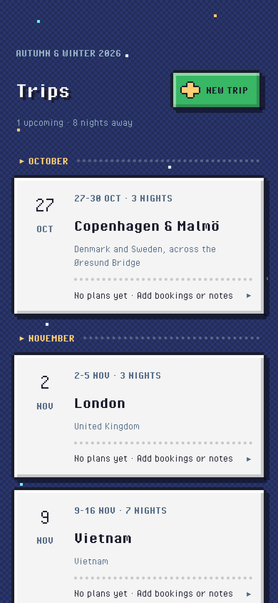
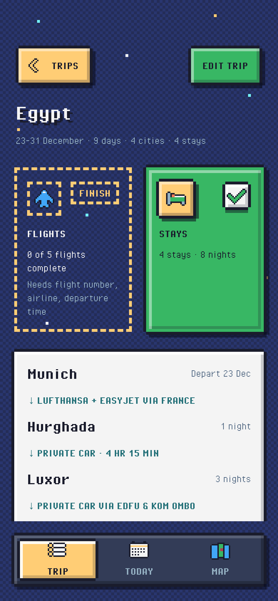
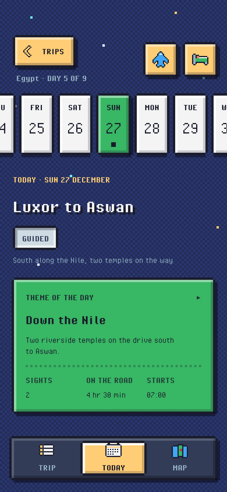

## TL;DR

Travelmate is a phone-first trip app: paste a booking email or a tour itinerary and Claude turns it into days, stops, commutes, stays and flights, then edits them when you ask. The one thing to remember: Claude never rewrites the trip, it only returns a small patch that the app validates and applies, so every change can be checked and undone.

## Fact box

| | |
|---|---|
| **Status** | Working and deployed for my own use behind an access code. Not open to the public <!-- TODO(prash): confirm it's live at travel.byteofprash.com --> |
| **Role** | Everything: product, design direction, testing. Built with Claude Code as my pair programmer, from a Claude Design handoff |
| **Stack** | Next.js (App Router) + TypeScript, `@anthropic-ai/sdk`, zod, Leaflet + OpenStreetMap, Upstash Redis, Cloudflare Email Worker, Docker on Hetzner |
| **Timeline** | First version in a day (28 Sep 2026), then about four weeks of changes up to 26 Oct 2026 |

## The itch

<!-- TODO(prash): add the real moment. Which trip, what was scattered where (emails, PDFs, notes, chat), and what you wished you could open on the day. A concrete scene beats this paragraph. -->

On a trip, the plan lives in five places: a flight confirmation in one email, a hotel in another, a tour operator's PDF, some notes. What I wanted when standing in a street was one screen that answers three questions: where am I going today, how do I get there, and where am I sleeping tonight. Trip planners tend to be built for the planning, not for the day itself, so I started from a Claude Design handoff for exactly that screen and built the app around it.

## What it does

The app opens on your trips. Each trip has an **overview** (flights, stays, the route), a **Today** view (a day strip, the day's theme, the stops with the commutes between them, and a "now" line when it's actually that day) and a **map**.



You build a trip by pasting text. **New trip** takes a booking email, a tour itinerary or loose notes, and Claude names the trip, works out the dates and creates the days, stays and journeys. After that, **Edit trip** takes plain-English requests: "move dinner to 20:00", "swap the hotel on day 3", "rename this trip", "push everything back two days". Every edit can be undone.



The overview is honest about what's missing. A flight only counts as complete with a flight number, an airline, a date and a departure time, so the Flights tile stays dashed ("0 of 5 flights complete, needs flight number, airline, departure time") until it has them. Claude is told to fill those only when the text states them, and never to guess.



The app is a PWA, so it works offline from the saved copy. It adapts to desktop with a collapsible sidebar, and you can forward booking emails to an address of your own and find them waiting in the app.

**What it deliberately doesn't do:** no accounts (one access code locks the whole app), no booking or payments, no live flight tracking, no PDF or attachment reading (only the text of an email), and nothing from an email is applied automatically. You choose the trip and press Apply.

## How it works

```
phone / laptop (PWA)                    server (Docker, Hetzner)              services
  trips in localStorage  ──────────►  /api/edit      ──────────────────►  Claude (tool call → patch)
  Undo history per trip  ──────────►  /api/new-trip  ──────────────────►  Claude (create_trip)
  sync on change, on focus ◄────────►  /api/state     ◄────────────────►  Upstash Redis (one JSON doc + revision)
  inbox banner             ◄──────────  /api/inbox     ◄── /api/inbound ◄──  Cloudflare Email Worker ◄── forwarded email
```

- **`lib/ops.ts`**: the patch format. Claude returns `{ summary, ops }` through one tool, and zod validates every op before `applyOps()` copies the trip, applies them and fills in defaults.
- **`lib/server/tool-schemas.ts`**: spells out every operation, field, type and allowed value for Claude.
- **Local-first storage**: the trip lives in `localStorage` and keeps working offline. Redis holds one JSON document with a revision number, so two devices can't silently overwrite each other.
- **Access code**: every API route needs it and fails closed if the server has none set.
- **`lib/theme.ts` + `app/globals.css`**: all the styling, so re-theming is two files.

### Decisions & trade-offs

- **Chose patches over letting Claude rewrite the whole trip**, because a patch is small, cheap, checkable and undoable. The trade-off is that the model has to speak a fixed vocabulary of operations, so adding a new kind of change means extending the schema.
- **Chose local-first plus one synced document over a database with tables**, because the trip is naturally one document and the app should work with no signal. The trade-off is conflict handling: if two devices both change, the app asks which copy to keep instead of merging.
- **Chose a single access code over user accounts**, because it's one person's app and accounts would have been most of the work. The trade-off is that anyone with the code has full access.
- **Chose OpenStreetMap through Leaflet over Google Maps**, because Google needs a billing account and charges beyond a free allowance. The trade-off is lighter tiles and no place search.
- **Chose a Docker container on my own server over Vercel**, which is where it started. I already run a shared Traefik and Cloudflare Tunnel setup, and long Claude calls aren't bound by serverless limits. The trade-off is that Cloudflare's roughly 100-second proxy timeout now applies.
- **Skipped Anthropic's `strict: true` tool mode**, because it caps how many optional fields a schema may have and the itinerary format has far more than that. I validate every answer myself instead.
- **Skipped auto-applying forwarded emails.** Email is untrusted input, so it only sits in an inbox until I review and apply it.

## What was hard

**Getting Claude's edits to apply reliably.** The first version validated the answer and failed if anything was off. Real answers were off in small, harmless ways: a `null` for an empty field, a number sent as text, and most often a whole list sent as JSON text inside a string (`"ops": "[{...}]"`). Strict mode was ruled out (see above). What worked, in layers: spell out every operation in the tool schema, tell Claude that nested values are real arrays and objects, accept the harmless slips in the validator, parse JSON-in-a-string, and if it still fails, send the answer back once with exactly which fields were wrong. Only after that does the sheet show an error, and it names the failing field. I also made the error messages say why something failed (key rejected, out of credit, unknown model, busy, timed out), with Anthropic's request ID, because a single generic "something went wrong" cost me hours.

**Debugging a failure that wasn't Anthropic's.** At one point every call returned a 503 "credential validation failed" with no request ID. A bad key gets a 401 with a request ID from Anthropic, so something else was answering. That's why `/api/health` now reports which host requests go to, what kind of key it is, whether it has stray quotes or spaces from pasting, and whether the reply carries Anthropic's request ID. <!-- TODO(prash): say what the cause turned out to be, if you found it. -->

## What I learned

- **Technical:** make the model's output a small, validated format and keep your own code in charge of applying it. Putting validation, defaults and undo in one place made the model's mistakes cheap. Write diagnostics (a health check that never returns the key) before you need them.
- **Product:** show what's missing instead of hiding it. The dashed "needs flight number" tile did more for trust than any amount of polish. Four visual styles in four weeks (DB-style, clay, 8-bit pixel art) was cheap because the tokens lived in two files, and I'd still keep it that way.
- **Process:** a Claude Design handoff gave me real spacing and copy to build against instead of guessing. Keeping the README current as I went made handing over the next change easy.
- **Differently next time:** decide on hosting before building. I moved from Vercel to my own server in week four.

## What's next

- Store a timezone per day, so the "now" line follows the trip's local time.
- Read PDF tickets, not just email text.
- A "Now / Next" widget for the lock screen.
- Rate limiting on the Claude routes: every request spends my credits.
- Open question: is one access code enough if I share a trip with someone travelling with me?

## Try it

- **Demo:** none public. It's locked behind an access code because every request spends my Anthropic credits.
- **Source:** [github.com/byteofprash/travelmate](https://github.com/byteofprash/travelmate)
