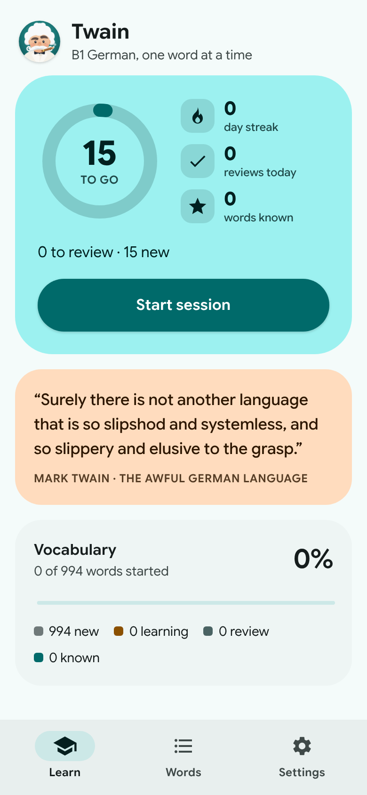
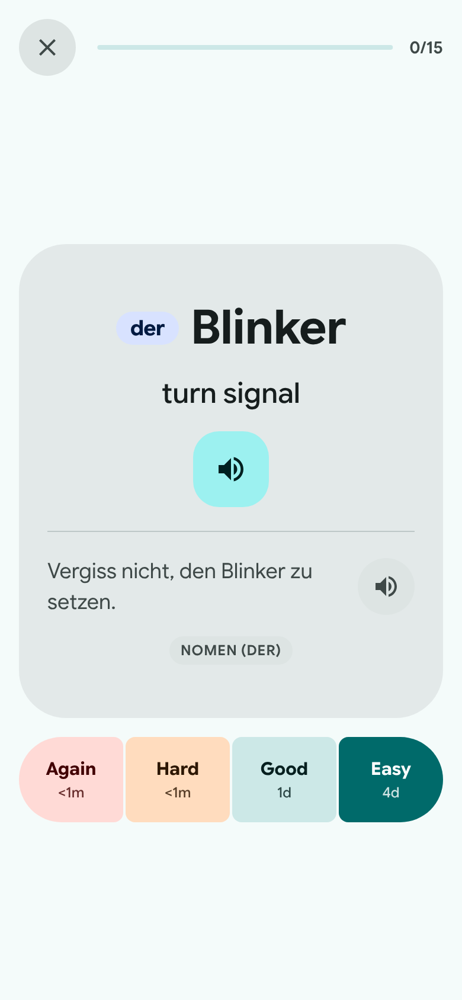

## TL;DR

Twain started as a bar bet that an app is easy to build once you have a design system. It is a flashcard app that drills the 994 words of a German B1 word list: you see a word, hear it, flip, rate how well you knew it, and a spaced-repetition scheduler decides when it comes back. It is a static site with no backend or API key, so the one thing to remember is that everything (scheduling, audio, progress) lives in the browser.

## Fact box

| | |
|---|---|
| **Status** | Built and pushed to `master`; deploys to Vercel on push, and a Docker + Traefik setup for my Hetzner server is documented |
| **Role** | Everything: product, design, code, logo (built with Claude Code) |
| **Stack** | Vanilla JS, CSS, no build step · Web Speech API · `localStorage` · nginx in Docker · Cloudflare Tunnel + Traefik · Vercel |
| **Timeline** | About two weeks, Nov 2026, in evening sessions |

## The itch

It started as a bar bet. I told Vishvesh that if you already have a design system ready, building an app these days is super easy. He took the other side, so we made it a bet.

I had the design system: the 8-bit pixel-art look from my travel app. All I needed was something to build with it. I also had a B1 German word list as a PDF, about a thousand words with a translation, an example sentence and the article for each noun. A PDF is good for reading and bad for remembering, so a flashcard app that quizzes me on it was the obvious test case.

<!-- Add how the bet ended, if you want to: who paid, and what Vishvesh said when he saw it. -->

## What it does

Every day it hands you a short session: due reviews first, then up to 15 new words (configurable). Each card plays the German aloud, you flip it, and you press Again, Hard, Good or Easy. The buttons show when you'll next see the card. Cards you miss come back later in the same session.

It also has a searchable word list with filters, three card styles (German to English, English to German, and listening-only), light and dark themes, and a backup you can export and import. The logo is a caricature of Mark Twain, who wrote *The Awful German Language*, and the app quotes him.

What it deliberately doesn't do: no accounts, no cloud sync, no streak guilt-tripping, no AI. Progress stays on the device.

## How it works

It is a static site. There is nothing to run besides a file server.

- **Data:** `words.json`, generated once from the PDF by a script (see below). Each entry has the German word, translation, example, word type and article.
- **Scheduler (`srs.js`):** an SM-2-style algorithm, written as pure functions so I could test it in Node. A card is new, learning or review, with an ease factor and an interval in days.
- **Audio:** the browser's built-in speech synthesis, set to `de-DE`.
- **State:** one JSON blob in `localStorage` (cards, daily counts, settings).
- **UI (`app.js`):** about 450 lines of plain DOM code, no framework.
- **Hosting:** the same repo serves two ways: a Docker image (nginx) behind Traefik and a Cloudflare Tunnel on my Hetzner server, and Vercel, which serves the `site/` folder directly.

### Decisions & trade-offs

- **Static site over Next.js.** My travel app uses Next.js, but Twain has no server logic, so a static site is cheaper to host and can't break on a missing API key.
- **Browser speech over a text-to-speech API.** It is free and works offline, but the quality depends on the voices installed on the device. I accepted that and added a voice picker.
- **SM-2 over FSRS.** FSRS predicts better, but SM-2 is about 60 lines I can read in one go. I skipped FSRS for now.
- **`localStorage` over a backend.** No sync between phone and laptop, in exchange for no accounts and no database. Export and import cover moving devices.
- **All 994 words, not "the 1000 most common".** The list I had isn't ranked by frequency, so I kept it whole and introduce new words in a fixed shuffled order, with A to Z as an option, instead of pretending it is a frequency list.
- **Material 3 Expressive over my usual pixel-art look.** I first built it in 8-bit style like my other apps, then redesigned it after looking at how Google's health apps are put together. Rounded shapes, spring motion and tonal colour suit a daily-use tool better than a novelty style.

## What was hard

**Getting the words out of the PDF.** Copying the text gave me garbled words: "Abfall" came out as "Abf" and "Versicherung" as "Versicherng". The PDF's font had no Unicode map for a few letters, so the text extractor either dropped them or returned private-use characters. Looking at the raw characters showed a small, consistent set (a, l, u, ä, ü and some punctuation), so I mapped them back by hand. A second problem was that multi-line cells broke the row order, so I rebuilt the table from character positions, using the word-type column to mark where each row starts. That produced 994 clean entries, and I spot-checked a sample against the PDF.

**Making buttons feel alive.** Material 3 Expressive buttons morph from a pill to a rounded square when pressed. A naive `border-radius: 9999px` doesn't animate nicely, because nothing visible changes until the value drops below half the height. The fix was to set the radius to exactly half the button's height, so the transition is smooth from the first frame.

## What I learned

- **Technical:** PDFs hide structure. Look at the characters before trusting the text. Pure functions for the scheduler made it easy to test without a browser.
- **Product:** a daily limit on new cards matters more than any clever algorithm. Without it the review pile snowballs.
- **The bet:** with a design system ready, the first working version came together in one sitting: the colours, fonts, panels and icons were already decided, so I only had to build the app. The catch showed up later. When I switched to a different design system, the whole UI layer had to be rewritten. Keeping state, logic and styling separate meant only that layer changed and existing progress survived, but a design system saves time only if you stick with it.
- **Different next time:** I'd decide the word source first. Starting from a frequency-ranked list would have answered "most common words" properly. I'd also pick the design system once, before writing any UI code.

## What's next

- Sort the words by real frequency, so the most useful ones come first.
- Optional sync between devices.
- Better audio: pre-generated recordings so every device sounds the same.
- Try FSRS and compare it with SM-2 on my own review history.
- Open question: is audio worth the effort for example sentences, or is the single word enough?

## Try it

- Demo: _add the Vercel URL once confirmed_ (the Hetzner copy sits behind Cloudflare Access, so it is private)
- Source: [github.com/byteofprash/twain](https://github.com/byteofprash/twain) (currently a private repository)
